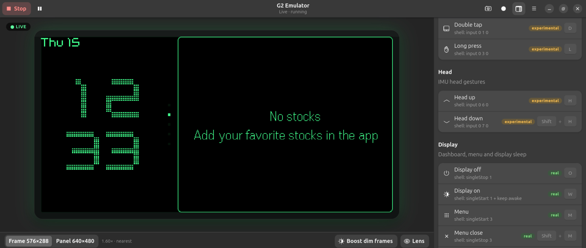

# G2 Emulator (g2emu)

The real Even G2 firmware running in Renode, its display shown live in a native GNOME app
(GTK4 + libadwaita), with buttons/keys driven by a config file. Think "QEMU for the glasses".

.png)

## Quickstart

    cd tools/renode-emu
    ./g2emu.sh                                            # live: starts Renode headless (8G cap), shows the display
    ./g2emu.sh --replay frames/first_light_cmdlists.bin   # no Renode: play / step / scrub a capture
    ./g2emu.sh --demo                                     # live UI on a fake backend (never starts Renode)
    ./g2emu.sh --tk ...                                   # the old Tkinter UI (app.py), unchanged

## Features
- **Genuine Firmware Emulation**: Runs unmodified Even G2 smart glasses binaries using Renode.
- **Modern Native UI**: Silky-smooth rendering utilizing a GTK4 and `libadwaita` desktop frontend.
- **Zero-Renode Replay**: Play back, step frame-by-frame, and scrub raw command list captures without launching the heavy emulator.
- **Configurable Inputs**: Drive the glasses hardware buttons and touchpad gestures using your local keyboard.

---

### What Works Now
- **Firmware Execution**: Successfully booting the real Even G2 firmware within the Renode environment.
- **Live Display**: High-performance frontend rendering the glasses' display output in real-time.
- **Frame Playback**: Replaying and scrubbing static bin captures (`--replay`).

### Under Development
- **Input Mapping**: Finalizing the configuration file schema to map physical keyboard keys to hardware touchpads.
- **Peripheral Emulation**: Fleshing out mock sensors (IMU, battery, ambient light) to satisfy firmware initialization loops.

---

## Prerequisites
Ensure you have the following dependencies installed on your system:
- **Linux** (GNOME environment recommended for best compatibility)
- **Renode** (latest stable release)
- **GTK4** and **libadwaita** development libraries
- **Python 3.10+** (if utilizing auxiliary tools)

---

## License
This project is licensed under the **MIT License**. See the `LICENSE` file for details.
