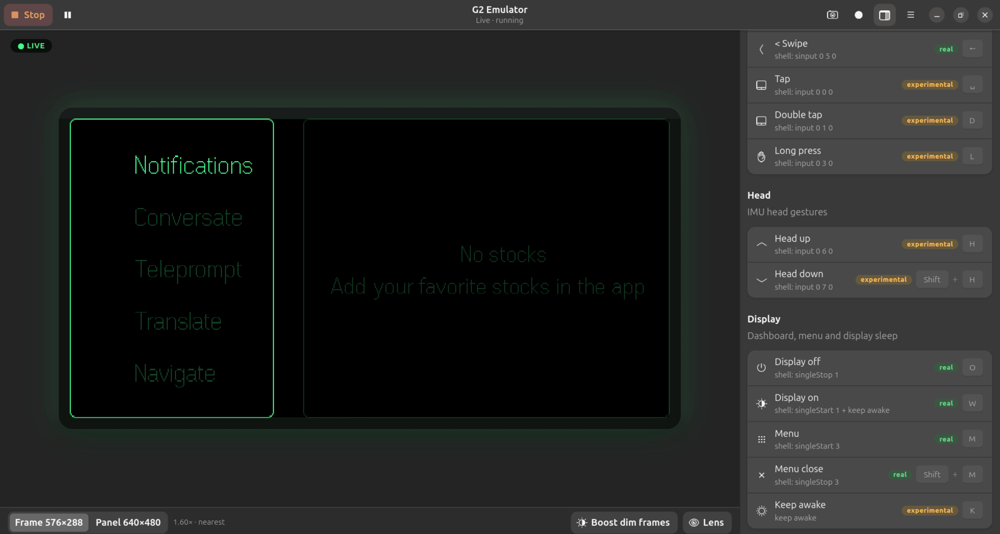
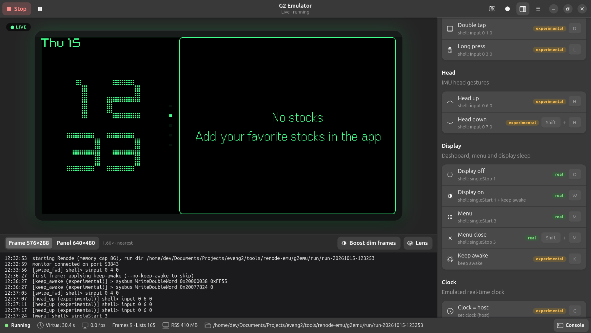

# G2 Emulator (g2emu)

The real Even G2 firmware running in Renode, its display shown live in a native GNOME app
(GTK4 + libadwaita), with buttons/keys driven by a config file. Think "QEMU for the glasses".

## Quickstart

    cd tools/renode-emu
    ./g2emu.sh                                            # live: starts Renode headless (8G cap), shows the display
    ./g2emu.sh --replay frames/first_light_cmdlists.bin   # no Renode: play / step / scrub a capture
    ./g2emu.sh --demo                                     # live UI on a fake backend (never starts Renode)
    ./g2emu.sh --tk ...                                   # the old Tkinter UI (app.py), unchanged

